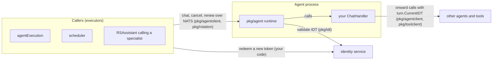
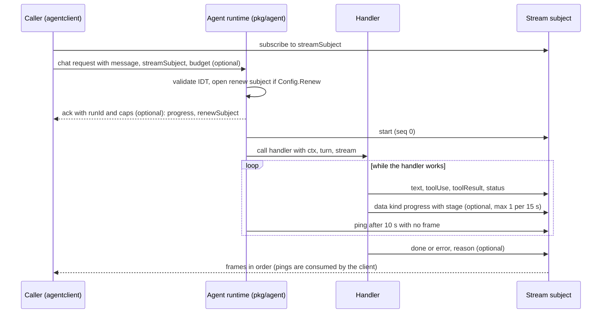
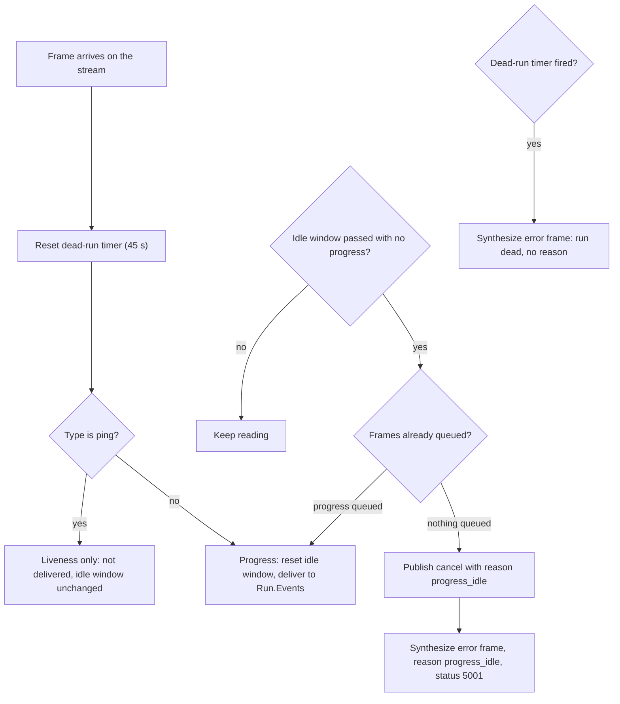
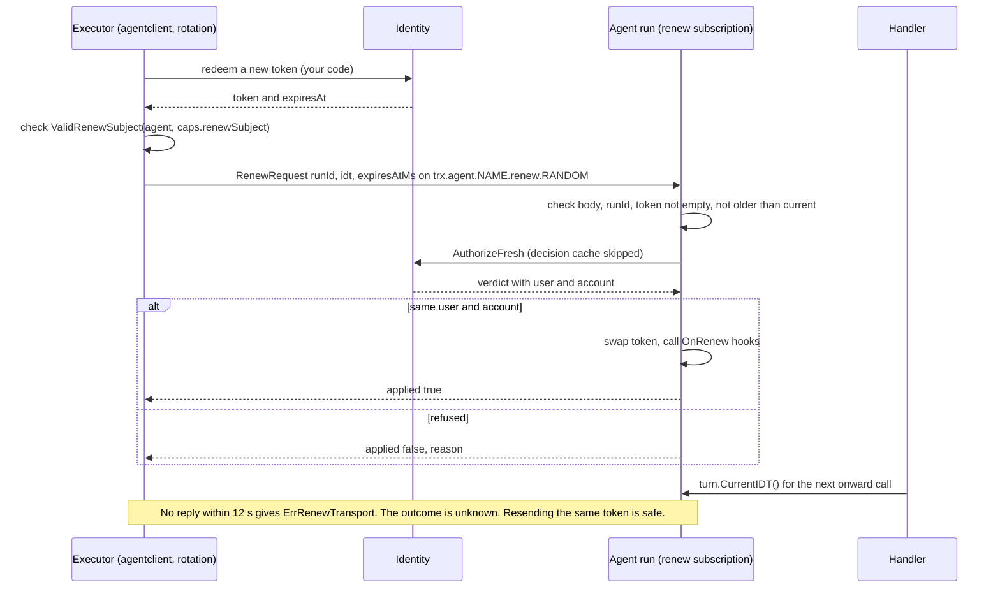
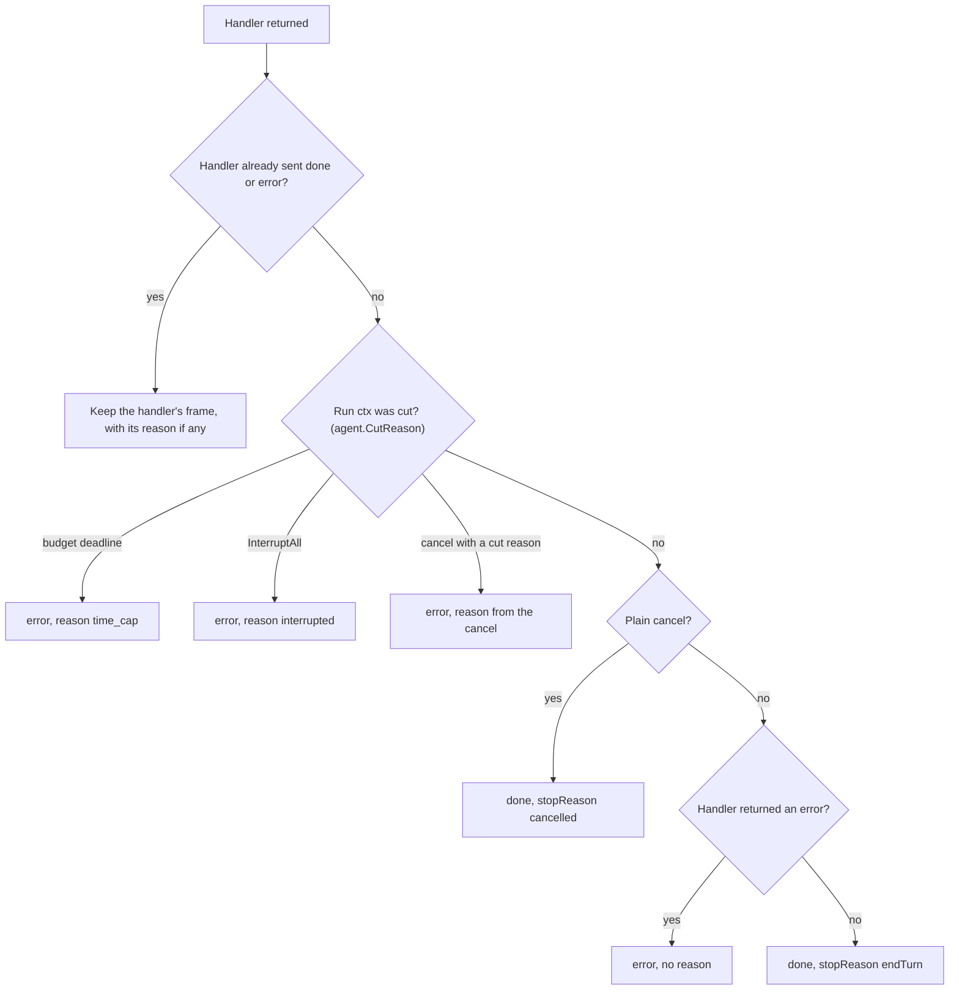
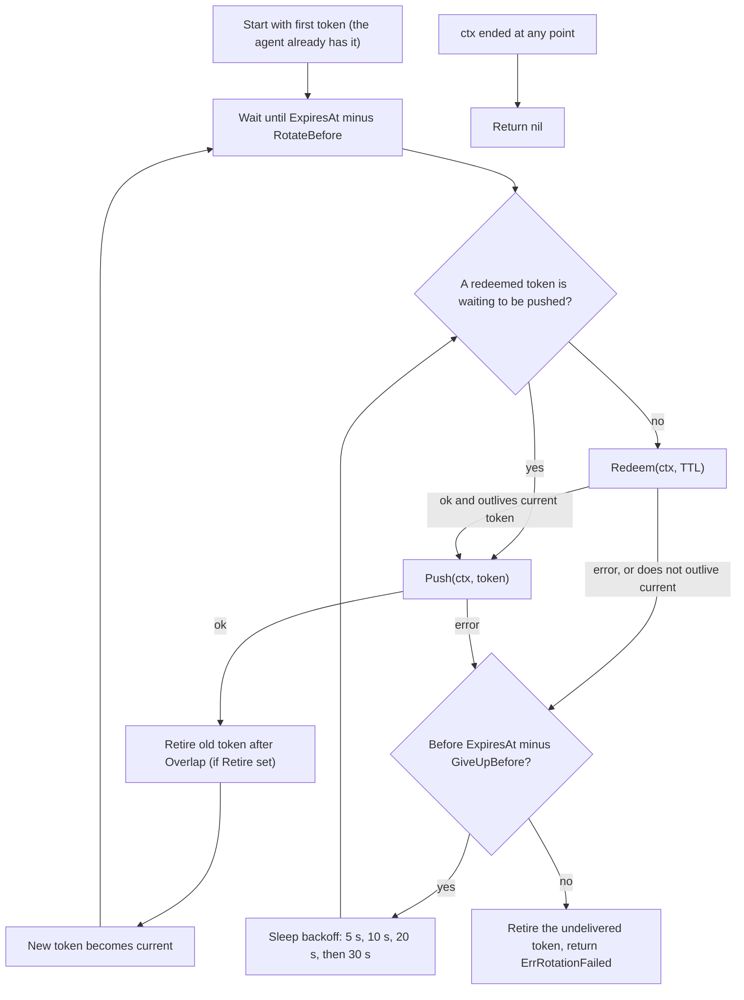

# Long turns (protocol 1.5)

This page explains the "long turn" features added in agent protocol 1.5
(`wire.ProtocolVersion = "1.5"`). It is for engineers who build agents or
callers with this library. The wire rules are in [SPEC.md §12](../SPEC.md#12-long-turns-v15);
this page shows how the Go code behaves. Where the two differ, this page
follows the code.

Terms used on this page:

- **Turn** or **run**: one chat request and everything streamed for it,
  identified by `runId`.
- **Caller**: the program that starts a turn (uses `pkg/agentclient`).
- **Agent**: the program that serves the turn (uses `pkg/agent`). Its code
  for one turn is the **handler** (`ChatHandler`).
- **Frame**: one event published on the turn's stream subject
  (`wire.AgentEvent`).
- **Terminal frame**: the last frame of a turn, `done` or `error`.
- **IDT**: Internal Delegation Token, the user's token sent in the
  `X-TRX-IDT` header.
- **Cut**: a turn ended by a limit (time, idleness, shutdown, token, a
  missing service), not by the model or the user.

## 1. What this adds

- **Time budget**: the request may carry `budget.remainingMs`. The agent
  ends the turn 5 s before that time. Used by callers with a hard time limit.
- **Progress signal**: the agent may send `data` frames of kind `progress`
  (at most one per 15 s). Used by agents that opt in, read by callers.
- **No-progress cut**: the caller ends a turn when no progress arrives for
  its idle window. Used by callers, only against agents that declared progress.
- **Renew (token rotation delivery)**: the caller sends a fresh IDT to a
  running turn. Used by callers with short-lived tokens; agents opt in.
- **Cut reasons**: `done`/`error` frames and cancel requests may carry
  `reason` (e.g. `time_cap`). Used by both sides to tell a cut from a user
  cancel.
- **Interrupt on shutdown**: `Agent.InterruptAll()` ends running turns with
  reason `interrupted`. Used by agents that stop while turns are still running.
- **Rotator**: `pkg/rotation` redeems and pushes new tokens before the
  current one runs out. Used by callers.
- **History `incomplete`**: a stored message may say why it was cut short.
  Used by agents that keep sessions and by UIs that show history.

## 2. Who is who



- Both sides share the JSON types in `pkg/wire`.
- A caller uses `pkg/agentclient` to start turns, and `pkg/rotation` if it
  must keep the turn supplied with tokens.
- An agent uses `pkg/agent`. The runtime checks every token with identity
  through `pkg/idt`.
- An agent that consults another agent (e.g. RSAssistant calling a
  specialist) is an agent and a caller at the same time.

## 3. One turn, end to end



Optional fields, all added in 1.5:

| Where | Field | Absent means |
|---|---|---|
| `ChatRequest` | `budget.remainingMs` | No deadline from the caller. |
| `ChatAck` | `caps` | Agent opted into nothing, or is older than 1.5. |
| `ChatAck.caps` | `progress` | No progress promise. The client does no idle cut. |
| `ChatAck.caps` | `renewSubject` | This run cannot be renewed. |
| `AgentEvent` (`done`/`error`) | `reason` | The turn was not cut. |
| `CancelRequest` | `reason` | A plain (user) cancel. |
| `StoredMessage` | `incomplete` | The message is complete. |

Details:

- The budget sets the handler's `ctx` deadline to `remainingMs - 5 s`, never
  less than 1 s (`runContext` in `pkg/agent/agent.go`). The deadline's cause
  is `agent.ErrTimeCap`.
- The ack carries `caps` only when the agent set `Config.Progress` or
  `Config.Renew`. With `Renew` only, `caps.progress` is false.
- `Run.Caps` in the client is the ack's `caps`, or the zero value.

## 4. Liveness vs progress

Two different signals:

- **Ping** (`type:"ping"`) means "the agent is alive". The runtime sends it
  by itself after 10 s without any frame. You never send it.
- **Progress** means "the work is moving". Every frame except `ping` counts
  (`AgentEvent.IsProgress`). A `data` frame of kind `progress` also carries
  a `stage` (e.g. `model`, `tool`) that the client keeps for its messages.

| | Ping | Progress |
|---|---|---|
| Proves | The agent process is alive | The turn is doing work |
| Sent by | The runtime, automatically | Any real frame; `stream.Progress` for explicit ones |
| Rate | After 10 s of silence (checked every 5 s) | `stream.Progress`: at most 1 per 15 s, extra calls dropped. Other frames are not throttled |
| Resets the dead-run timer (45 s) | Yes | Yes |
| Resets the idle window | No | Yes |
| Reaches `Run.Events` | No | Yes |



Rules from the code (`pkg/agentclient/client.go`, `pkg/progress/watcher.go`):

- The idle cut runs only if the caller set `ChatOptions.IdleWindow > 0`
  **and** the ack declared `caps.progress`. Otherwise `IdleWindow` is ignored.
- The idle window starts when the ack is received.
- On idle, the client first handles frames that were already queued. Only
  with nothing (or only pings) queued does it cut.
- The cut: the client publishes a cancel with reason `progress_idle`
  (fire and forget), then ends `Run.Events` with a synthesized `error` frame:
  `reason:"progress_idle"`, `errorStatus` 5001, message
  `run idle: no progress for <window> (last stage: <stage>)`.
- The agent then ends its own run with reason `progress_idle`. The client
  has already closed the stream and does not see that frame.
- A handler that waits on a slow call longer than the caller's idle window
  must emit something meanwhile, such as `stream.Progress` or `stream.Status`.
  Because `stream.Progress` sends at most one frame per 15 s, an idle window
  of 15 s or less can cut an agent that only sends progress frames.

## 5. Token renew

A turn can last longer than the caller's token. Renew hands the running turn
a new token without restarting it.



What the agent checks (`pkg/agent/renew.go`), and the refusal reason for each:

| Check | Reason on failure |
|---|---|
| Body is valid JSON | `bad_request` |
| `runId` is this run | `wrong_run` |
| Token is not empty | `invalid_token` |
| `expiresAtMs`, if set, is not before the current token's known expiry | `stale_token` |
| Identity accepts the token (fresh, no cache) | `invalid_token` |
| Same user and account as the run; a verified run needs a verified token | `identity_mismatch` |

More rules:

- A refused renew changes nothing. The run keeps its current token.
- A renew that arrives after the run ended gets no reply. The caller sees a
  timeout (`ErrRenewTransport`).
- After a swap, new onward calls use the new token. Calls already in flight
  keep the token they started with. The agent never revokes the old token.
- `turn.Identity.IDT` always keeps the first token. Use `turn.CurrentIDT()`.
- For a run that was not verified at admission (validation off,
  observe-only, fail-open), the agent may ask identity twice: once for the
  new token and once to learn who the run's caller is. That is why the
  client waits 12 s (two checks of up to 5 s each).
- Client errors: `ErrRenewUnsupported` (no valid renew subject, nothing
  sent), `ErrRenewRejected` (wraps the reason; only an explicit
  `{"applied":false}`), `ErrRenewTransport` (no well-formed reply).
- Another instance of the agent also receives each renew (service queue
  group on `trx.agent.<name>.>`). Current instances stay silent; an older
  build answers with a 404 service envelope, often first. The client skips
  any reply with an error status or without a boolean `applied` and waits
  for the run's own reply, so a mixed-version fleet (rolling deploy, a
  regional twin on an older build) cannot turn an applied renew into a
  refusal.

**Why this subject.** The renew subject is
`trx.agent.<agentName>.renew.<22 random base64url characters>`, one per
run. It lives in the agent's own subject space: the agent already
subscribes to `trx.agent.<name>.>` and its callers already publish there.
So no extra NATS permission is needed, and other agents cannot subscribe to
it. It never uses `_INBOX`, because every service may subscribe there. The
subject is created and subscribed before the ack is sent, and removed when
the run ends. `<agentName>` is the registered name, never a regional alias.
Callers must only send a token to a subject that passes
`agentclient.ValidRenewSubject` for the agent they started the run on;
`Run.Renew` enforces this.

## 6. How a turn can end

The agent runtime picks the terminal frame in this order
(`handleChat` in `pkg/agent/agent.go`):



**The first cause decides.** The run's context records only its first
cancel cause. A cut stays a cut if a plain cancel follows. A plain cancel
stays a plain cancel if a cut follows.

Every ending and who produces it:

| Ending | Frame | Produced by |
|---|---|---|
| Model finished | `done`, `stopReason:"endTurn"` | Library default, or handler |
| User cancel | `done`, `stopReason:"cancelled"` | Library (plain cancel) |
| `time_cap` | `error` + reason | Library: budget deadline. Also accepted on a cancel |
| `progress_idle` | `error` + reason | Library: client idle cut, and the agent on the reasoned cancel |
| `interrupted` | `error` + reason | Library: `InterruptAll`. Also accepted on a cancel |
| `token_rotation_failed` | `error` + reason | Caller application: sends `CancelWithReason` after `pkg/rotation` returns `ErrRotationFailed`. The library does not send it by itself |
| `unavailable` | `error` + reason | Application: a caller's reasoned cancel, or a handler |
| `max_iterations` | handler's choice | Application only (handler uses `DoneWithReason`/`ErrorWithReason`). Not accepted as a cancel reason |
| `subagent_timeout`, `subagent_idle` | handler's choice | Application only, as above |

Notes:

- Only five reasons turn a cancel into a cut: `progress_idle`,
  `token_rotation_failed`, `interrupted`, `time_cap`, `unavailable`. Any
  other cancel reason is a plain cancel.
- When the runtime writes the cut frame, the text is fixed per reason
  (e.g. `time limit reached`), `errorStatus` is 5002, and the handler's own
  error text is not shown.
- The client may also end `Run.Events` itself with a synthesized `error`
  (`errorStatus` 5001): on idle (`progress_idle`), when no frame arrives for
  45 s (no reason), or when the caller's `ctx` is cancelled (no reason; it
  also publishes a plain cancel).

## 7. The rotator (`pkg/rotation`)

`rotation.Run` keeps a turn supplied with short-lived tokens. It knows
nothing about NATS or identity: you give it `Redeem` (get a new token) and
`Push` (deliver it, usually `Run.RenewWithExpiry`), and optionally `Retire`.



Rules from `pkg/rotation/rotator.go`:

- The next rotation is scheduled from the `ExpiresAt` that `Redeem`
  returned, never from `TTL`.
- A redeemed token that fails to push is pushed again; it is not redeemed
  again.
- Each `Redeem`/`Push` attempt's ctx ends at the give-up point.
- The config must have `Redeem`, `Push`, `TTL > 0`,
  `GiveUpBefore >= 0` and `RotateBefore > GiveUpBefore`. The first token
  must have an `ExpiresAt`. An invalid config is returned at once.
- There are no defaults. The design values are `RotateBefore` 8 min and
  `GiveUpBefore` 2 min (field comments and SPEC §12.6); you must set them.
  `Overlap` 0 means retire right after the push.
- On `ErrRotationFailed`, the caller should end the turn with
  `CancelWithReason(ctx, wire.ReasonTokenRotation)`.

## 8. How to use it

Bumping the library changes nothing until an agent sets `Config.Progress`
or `Config.Renew`, with three exceptions that apply to every 1.5 agent
(README "Long turns", confirmed in `pkg/agent/agent.go`):

1. A request `budget` is honoured (ctx deadline, cause `agent.ErrTimeCap`).
2. A cancel carrying a cut reason ends the turn as a cut.
3. `InterruptAll` ends turns as interrupted.

In those three cases the turn ends with an `error` carrying `reason`
instead of `done`/`cancelled`.

### (a) Agent: opt in

```go
a, err := agent.New(agent.Config{
    Name:        "copayAssistant",
    Description: "Answers copay questions.",
    Progress:    true, // ack caps.progress, stream.Progress sends frames
    Renew:       true, // ack caps.renewSubject, accepts fresh tokens
})
if err != nil {
    return err
}

a.OnChat(func(ctx context.Context, turn *agent.Turn, stream *agent.Stream) error {
    // Onward calls read the current token on every request,
    // so they pick up renewed tokens.
    octx := agentclient.WithIDTSource(ctx, turn.CurrentIDT)

    stream.Progress("model", "thinking") // dropped if sent < 15 s after the last one
    answer, err := callModel(octx)        // your code; must stop when ctx ends
    if reason := agent.CutReason(ctx); reason != "" {
        // Cut by budget, shutdown or a reasoned cancel.
        // Save partial work here (e.g. StoredMessage.Incomplete = reason).
        // Returning lets the runtime send error with this reason.
        return ctx.Err()
    }
    if err != nil {
        return err
    }
    stream.Text(answer)
    stream.Done(wire.StopEndTurn, nil)
    return nil
})
```

- Honour `ctx`: with a budget it has a deadline (`ctx.Deadline()`), and its
  cause tells you why it ended (`context.Cause(ctx)`, or `agent.CutReason`).
- If you send your own terminal frame after a cut, use
  `stream.ErrorWithReason(msg, wire.CodeInternal, agent.CutReason(ctx))` or
  `stream.DoneWithReason(...)` so the reason is not lost.
- Application reasons such as `wire.ReasonMaxIterations` are sent the same
  way.
- `turn.OnRenew(func(idt string) { ... })` runs after each accepted renew,
  before the reply. Keep it short.
- On shutdown: `a.Drain(ctx)` (let turns finish), then `a.InterruptAll()`
  (cut what is left), then `a.Shutdown()`.

### (b) Caller: budget, idle cut, renew

```go
c, err := agentclient.New()
if err != nil {
    return err
}
defer c.Close()

ctx = agentclient.WithIDT(ctx, firstIDT)
run, err := c.ChatWith(ctx, "copayAssistant", wire.ChatRequest{
    Message: wire.Message{Role: "user", Content: []wire.ContentBlock{{Text: question}}},
    Budget:  &wire.Budget{RemainingMs: time.Until(deadline).Milliseconds()},
}, agentclient.ChatOptions{IdleWindow: idleWindow}) // ignored unless run.Caps.Progress
if err != nil {
    return err
}

if run.Caps.RenewSubject != "" {
    go func() {
        err := rotation.Run(rotCtx, rotation.Config{
            TTL:          tokenTTL,
            RotateBefore: 8 * time.Minute,
            GiveUpBefore: 2 * time.Minute,
            Redeem:       redeemToken, // your identity call
            Push: func(ctx context.Context, t rotation.Token) error {
                return run.RenewWithExpiry(ctx, t.Value, t.ExpiresAt)
            },
        }, rotation.Token{Value: firstIDT, ExpiresAt: firstExpiry})
        if errors.Is(err, rotation.ErrRotationFailed) {
            _, _ = run.CancelWithReason(context.Background(), wire.ReasonTokenRotation)
        }
    }()
}

for ev := range run.Events { // drain until the terminal frame
    if ev.IsTerminal() && ev.Reason != "" {
        // cut: time_cap, progress_idle, interrupted, ...
    }
}
```

- `run.Renew(ctx, idt)` is `RenewWithExpiry` without an expiry. Sending the
  expiry enables the agent's `stale_token` guard.
- To cut a turn for your own limit, call
  `run.CancelWithReason(ctx, reason)` **before** cancelling the `ctx` you
  passed to `ChatWith`. Cancelling that `ctx` publishes a plain cancel, and
  the first cancel to reach the agent decides how the turn ends.
- Always drain `run.Events` until it closes; the reader blocks on a full
  channel.

## 9. Compatibility

| Case | What happens |
|---|---|
| Old caller (before 1.5) + 1.5 agent | No `budget`, so no deadline. The caller ignores `caps`, progress frames (unknown data kind) and `reason`. It never renews and never sends a reasoned cancel. Same behavior as before. |
| 1.5 caller + old agent | Ack has no `caps`, so `Run.Caps` is zero: no idle cut, `Run.Renew` returns `ErrRenewUnsupported`. The agent ignores `budget`. A reasoned cancel is a plain cancel (`done`, `cancelled`). No `reason` on frames. |
| 1.5 agent without opt-in | No `caps`, no progress frames (`stream.Progress` is a no-op), no renew subject, so no idle cut and no renew. Still honours `budget`, reasoned cancels and `InterruptAll` (`error` with `reason`). |
| 1.5 agent with `Renew` only | `caps` has `renewSubject`, `progress` false: renew works, no idle cut. |
| 1.5 agent with `Progress` only | `caps.progress` true: idle cut applies, no renew subject. |

Decide per run from `Run.Caps`, not from the card: during a rollout a turn
can land on an older instance.

## 10. Settings and numbers

| Setting | Value | Where |
|---|---|---|
| Ping after silence | 10 s (`heartbeatIdle`) | `pkg/agent/stream.go` |
| Heartbeat check interval | 5 s (`heartbeatCheck`) | `pkg/agent/stream.go` |
| Progress frame throttle | 1 per 15 s per run (`progressEvery`) | `pkg/agent/stream.go` |
| Budget margin | 5 s (`agent.BudgetMargin`) | `pkg/agent/agent.go` |
| Shortest budget deadline | 1 s (`minBudget`) | `pkg/agent/agent.go` |
| Dead-run timeout (no frame at all) | 45 s (`agentclient.DeadRunTimeout`) | `pkg/agentclient/client.go` |
| Idle window | none; 0 = off (`ChatOptions.IdleWindow`) | `pkg/agentclient/client.go` |
| Renew reply wait | 12 s (`agentclient.RenewTimeout`) | `pkg/agentclient/client.go` |
| Chat ack wait | 10 s (`agentclient.DefaultRequestTimeout`) | `pkg/agentclient/client.go` |
| Cancel reply wait | 2 s (`CancelWithReason`) | `pkg/agentclient/client.go` |
| Identity check timeout | 5 s default, env `IDT_VALIDATE_TIMEOUT_SECONDS` | `pkg/idt/idt.go` |
| Renew subject random part | 16 bytes = 22 base64url characters | `pkg/agent/renew.go` |
| Rotation backoff | 5 s, doubling, max 30 s | `pkg/rotation/rotator.go` |
| Rotation `RotateBefore` / `GiveUpBefore` | no default; design values 8 min / 2 min | `pkg/rotation/rotator.go` |
